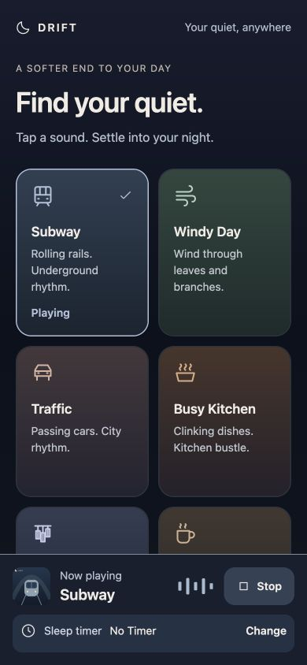
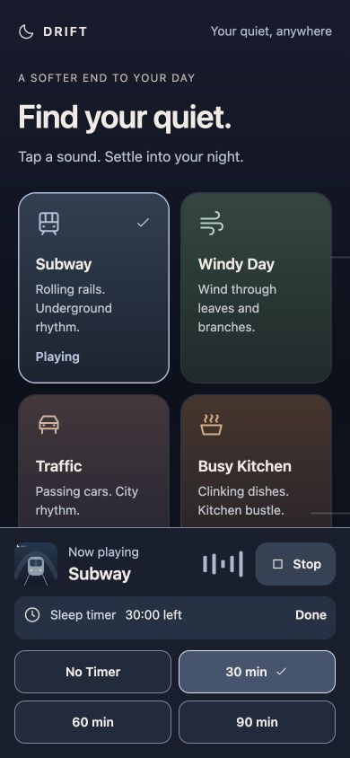
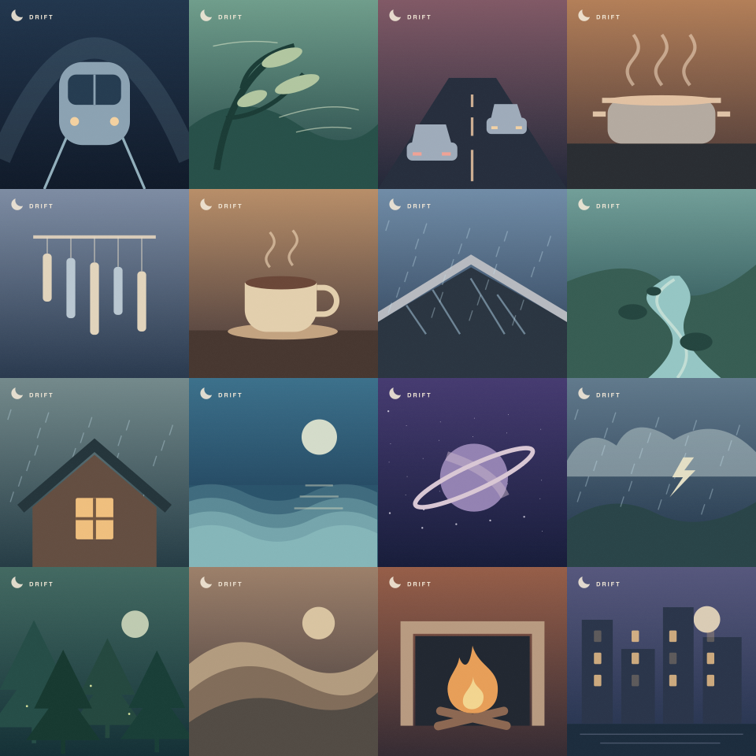

# Drift

Find your quiet with 16 looping soundscapes, an adjustable sleep timer, and offline listening. Drift is a mobile-friendly web app built with Expo and React Native, with no account, subscription, analytics, or backend.

**Listen now: [drift.stacklets.app](https://drift.stacklets.app)**

## Screenshots

| Mobile player | Sleep timer |
| --- | --- |
|  |  |

### Artwork for every sound



## Features

- Tap any sound to play immediately; tap another to switch.
- Continuous Web Audio loops with crossfaded recording boundaries.
- Persistent bottom player with Stop and expandable timer controls.
- No Timer, 30, 60, or 90 minutes. Changing the timer keeps playback running.
- Most-played sounds appear first when the app opens or refreshes. History stays on the device; ties use the most recent play.
- Installable Home Screen app with an explicit offline download flow.
- Individual artwork, sound titles, and Drift branding supplied to system media controls.
- Playback-linked atmospheric effects, optional tilt effects, scalable text, keyboard focus indicators, and support for reduced motion and increased contrast.

## Sounds

Subway · Windy Day · Traffic · Busy Kitchen · Wind Chime · Cafe · Rain on Roof · Stream · Rainy Cabin · Ocean Night · Deep Space · Monsoon · Forest Night · Brown Noise · Fireplace · City Night

Fourteen sounds use CC0 environmental recordings. Brown Noise and Deep Space are original synthesized soundscapes. Recordings are mastered from public HQ previews, not original lossless files. Creator credits, source links, license evidence, and processing details are in [AUDIO_LICENSES.md](AUDIO_LICENSES.md). The source manifest is in [assets/audio/sources/manifest.json](assets/audio/sources/manifest.json).

## Run locally

Use Node.js 22 or newer and pnpm 11.

```sh
git clone https://github.com/ghadgenilesh/drift-sounds.git
cd drift-sounds
pnpm install --frozen-lockfile
pnpm web
```

The app is built with Expo SDK 57, React 19, and React Native Web. Audio files are included in the repository, so the first clone is relatively large.

## Build and deploy

```sh
pnpm build:web
```

This exports the web app to `dist/` and generates its service worker, offline manifest, and social-sharing metadata. The post-export step is required.

For Cloudflare Workers static assets, deploy the **contents of `dist/`** to the existing Worker. For a ZIP upload, `index.html` must be at the archive root. Keep the custom domain configured as [drift.stacklets.app](https://drift.stacklets.app).

The public origin defaults to `https://drift.stacklets.app`. For another host:

```sh
SITE_ORIGIN=https://your-domain.example pnpm build:web
```

Updating this GitHub repository does not itself deploy the Cloudflare site unless you configure a deployment integration.

## Offline use on iPhone

1. Open [drift.stacklets.app](https://drift.stacklets.app) in Safari.
2. Tap Share, then **Add to Home Screen**.
3. Open Drift from the new icon and tap **Save sounds for offline**.
4. Keep it open until all 16 sounds are saved, then test once in Airplane Mode.

The audio pack is approximately 216 MB. Artwork and the interface are cached separately. Website data clearing or storage pressure can remove saved content. Safari and the installed Home Screen app can have separate storage, so save from the installed app.

HTTPS is required for installation and offline caching outside localhost. Cached audio supports Safari byte-range requests. Service-worker updates take effect after older windows close; the app avoids forcing a reload during playback.

## Checks

```sh
pnpm typecheck
pnpm build:web
pnpm test:pwa
pnpm test:gapless
pnpm test:history
pnpm test:metadata
pnpm test:timer
```

For audio checks and regeneration, install Python 3 with `numpy`, `scipy`, and `soundfile`:

```sh
python3 -m pip install numpy scipy soundfile
pnpm audio:check
```

`test:pwa` checks offline serving and Safari range responses. `test:gapless` checks playback and timer lifecycle. `test:history` checks ranking and storage failure handling. `test:metadata` verifies all cover images and their inclusion in the offline cache.

## Reproduce assets

```sh
python3 scripts/fetch_recordings.py
pnpm audio:generate
```

Original artwork sources and generated PNGs live in `public/artwork/v1/`. To regenerate covers, make the Node package `sharp` available or set `DRIFT_SHARP_MODULE` to its module path, then run:

```sh
pnpm artwork:generate
```

## Platform limitations

iOS controls the lock-screen player's layout and artwork presentation. Browser metadata and artwork caching are verified; final lock-screen rendering and background playback require testing on a physical iPhone. OS suspension can stop the audio context, so a locked-screen sleep deadline cannot be guaranteed in every situation.

The repository also retains native Expo support (`pnpm ios` / `pnpm android`). Native builds require the relevant platform tools; Expo Go alone does not provide full background-playback testing. The primary published experience is the web app.
